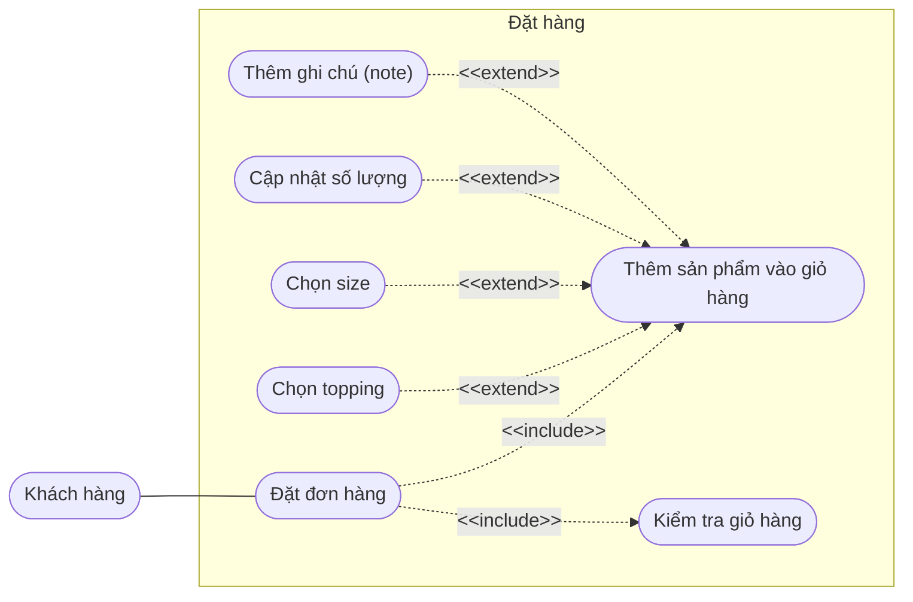
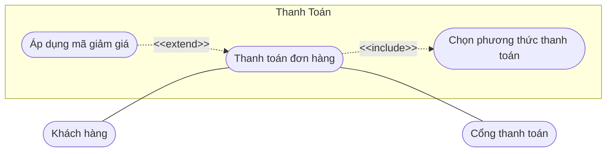

# TASK 1.3: ĐẶC TẢ MỘT USE-CASE TRỌNG TÂM (BREWLITE)
Nghiệp vụ ‘Đặt và thanh toán đơn hàng’ là một quy trình nghiệp vụ lớn (End-to-End process). Để đảm bảo tính phân rã rõ ràng theo chuẩn thiết kế hệ thống, nhóm đặc tả thành 2 ca sử dụng thành phần kế tiếp nhau: UC-01 (Đặt đơn hàng) và UC-02 (Thanh toán đơn hàng).
## 1. Vẽ use-case diagram

## 2. Đặc tả use-case Đặt đơn hàng (Sơ đồ đặt hàng)
|  **Thuộc tính** | **Nội dung mô tả chi tiết** |
|---|---|
| **Use-case ID** | UC-01 |
| **Use-case name** | Đặt đơn hàng |
| **Actor** | Khách hàng (Primary Actor). |
| **Requirement IDs** | FR-ORD-01, FR-ORD-02, FR-ORD-03, FR-ORD-04, FR-ORD-05, FR-ORD-06, FR-ORD-07 |
| **Description** | Khách hàng có thể sử dụng chức năng này để chọn sản phẩm từ thực đơn của cửa hàng thêm vào giỏ hàng, cùng với các lựa chọn tùy chỉnh khác (chọn size, chọn topping, cập nhật số lượng, thêm ghi chú), kiểm tra lại giỏ hàng và xác nhận đặt đơn hàng. |
| **Trigger** | Khách hàng truy cập vào màn hình thực đơn (Menu), chọn sản phẩm thêm vào giỏ hàng và nhấn nút "Đặt đơn hàng". |
| **Preconditions** | 1. Hệ thống đang hoạt động ổn định và kết nối cơ sở dữ liệu thành công. 2. Danh mục thực đơn (sản phẩm, size, topping, đơn giá, tồn kho) đã được cấu hình và đang ở trạng thái mở bán. 3. Khách hàng đã truy cập vào màn hình đặt món của hệ thống. |
| **Postconditions** | **Thành công:** Giỏ hàng được kiểm tra hợp lệ; đơn hàng mới được khởi tạo ở trạng thái `PENDING` (Chờ thanh toán), lưu đầy đủ danh sách món, size, topping, số lượng, ghi chú và tổng tiền tạm tính; hệ thống chuyển khách hàng sang màn hình Thanh toán đơn hàng.  **Thất bại:** Đơn hàng không được khởi tạo; trạng thái giỏ hàng hiện tại của khách hàng vẫn được giữ nguyên để khách hàng chỉnh sửa. |
| **Normal flow** | **1.** Hệ thống hiển thị màn hình đặt món và danh sách thực đơn (Menu) cho khách hàng.  **2.** (`<<include>>` Thêm sản phẩm vào giỏ hàng): Khách hàng lựa chọn sản phẩm từ thực đơn.  **3.** Hệ thống hiển thị chi tiết sản phẩm (size mặc định, số lượng mặc định là 1, danh sách topping đi kèm, ô nhập ghi chú).  **4.** Khách hàng tùy chọn size, topping, cập nhật số lượng và nhập ghi chú nếu cần, sau đó xác nhận "Thêm sản phẩm vào giỏ hàng".  **5.** Hệ thống lưu sản phẩm cùng các thông tin tùy chỉnh vào giỏ hàng và cập nhật tổng số lượng món trong giỏ.  **6.** (`<<include>>` Kiểm tra giỏ hàng): Khách hàng mở giỏ hàng để kiểm tra lại danh sách sản phẩm đã chọn, các tùy chỉnh đi kèm và tổng tiền tạm tính.  **7.** Khách hàng xác nhận đặt hàng sau khi kiểm tra thông tin giỏ hàng.  **8.** Hệ thống kiểm tra xem kho có đủ nguyên liệu để hoàn thành đơn hàng hay không.  **9.** Hệ thống tạo đơn hàng ở trạng thái PENDING, lưu thông tin đơn hàng và tổng tiền tạm tính.  **10.** Hệ thống chuyển khách hàng sang màn hình thanh toán đơn hàng để thực tiện chức năng thanh toán. |
| **Exceptions** | **EX-01 (Đơn hàng chứa món không đủ nguyên liệu):** Tại bước 8, hệ thống phát hiệu kho nguyên liệu không đủ để đáp ứng số lượng món trong đơn hàng. Hệ thống thông báo tên món không đủ nguyên liệu, không tạo đơn hàng và yêu cầu khách điều chỉnh giỏ hàng.  **EX-02 (Giỏ hàng trống):** Tại bước 6, khách hàng mở giỏ hàng nhưng chưa có sản phẩm nào, hoặc tại bước 7 khách hàng xác nhận đặt hàng khi thấy giỏ hàng trống. Hệ thống thông báo "Giỏ hàng đang trống, vui lòng thêm sản phẩm" và không cho phép tiếp tục đặt hàng.  **EX-03 (Số lượng không hợp lệ):** Tại bước 4 hoặc bước 6, khách hàng nhập số lượng nhỏ hơn hoặc bằng 0 hoặc vượt quá giới hạn cho phép. Hệ thống thông báo lỗi, yêu cầu khách hàng nhập lại số lượng hợp lệ và không tiếp tục xác nhận đặt hàng cho đến khi dữ liệu được điều chỉnh.  **EX-04 (Mất kết nối khi đặt hàng):** Tại bước 5, bước 6, bước 8 hoặc bước 9, hệ thống gặp lỗi kết nối mạng hoặc cơ sở dữ liệu trong quá trình cập nhật giỏ hàng, kiểm tra nguyên liệu hoặc tạo đơn hàng. Hệ thống thông báo lỗi, giữ lại dữ liệu giỏ hàng nếu có thể và bảo đảm không tạo trùng đơn hàng khi khách hàng thử lại.  **EX-05 (Mất kết nối khi chuyển sang thanh toán):** Tại bước 10, kết nối mạng bị gián đoạn khi hệ thống chuyển khách hàng sang màn hình thanh toán. Hệ thống thông báo lỗi kết nối và cho phép khách hàng thử lại. Đơn hàng đã được tạo vẫn được giữ nguyên; hệ thống không tạo thêm đơn hàng mới khi khách hàng thực hiện thao tác. |
| **Alternative flows** | **AF-01 (`<<extend>>` Chọn size - tại bước 3):** Khách hàng điều chỉnh kích cỡ sản phẩm (Size S, M, L). Hệ thống cập nhật lại đơn giá theo size rồi tiếp tục bước 4.  **AF-02 (`<<extend>>` Chọn topping - tại bước 3):** Khách hàng chọn thêm một hoặc nhiều loại topping ăn kèm. Hệ thống cộng thêm tiền topping vào giá món rồi tiếp tục bước 4.  **AF-03 (`<<extend>>` Cập nhật số lượng - tại bước 4 hoặc bước 6):** Khách hàng thay đổi số lượng sản phẩm khi tùy chỉnh món hoặc kiểm tra giỏ hàng. Hệ thống cập nhật số lượng, tính lại thành tiền của món và tổng tiền giỏ hàng. Nếu khách hàng xóa sản phẩm tại bước 6, hệ thống cập nhật giỏ hàng trước khi tiếp tục bước 7  **AF-04 (`<<extend>>` Thêm ghi chú (note) - tại bước 3):** Khách hàng nhập ghi chú riêng cho sản phẩm, chẳng hạn “Ít đá, 50% đường”. Hệ thống lưu ghi chú kèm theo sản phẩm trong giỏ hàng và tiếp tục bước 4 của luồng chính.  **AF-05 (Chọn món thay thế khi hết nguyên liệu - tại bước 8):** Hệ thống thông báo món không đủ nguyên liệu. Khách hàng chọn món thay thế hoặc xóa món không khả dụng khỏi giỏ hàng. Hệ thống cập nhật giỏ hàng và tính lại tổng tiền, sau đó quay lại bước 7 để khách hàng xác nhận đặt hàng. Hệ thống thực hiện lại bước 8 để kiểm tra nguyên liệu trước khi tạo đơn hàng. |
| **Tiêu chí chấp nhận**| **AC-01:** Hệ thống chỉ cho phép tạo đơn hàng khi giỏ hàng có ít nhất một món hợp lệ, số lượng của mỗi món lớn hơn 0 và tồn kho nguyên liệu cần thiết để chế biến các món cùng topping đáp ứng đủ số lượng đặt.  **AC-02:** Khi tạo đơn hàng thành công, hệ thống phải cấp mã đơn hàng duy nhất, lưu đơn hàng với trạng thái `PENDING` (Chờ thanh toán) và tính tổng tiền chính xác dựa trên giá của từng món theo size, các topping được chọn và số lượng tương ứng.  **AC-03:** Hệ thống không được tạo đơn hàng nếu giỏ hàng rỗng, số lượng món không hợp lệ hoặc dữ liệu đặt hàng không đáp ứng các điều kiện nghiệp vụ. Khi tạo đơn thất bại, hệ thống phải thông báo lý do phù hợp cho khách hàng.  **AC-04:** Tổng tiền đơn hàng được lưu phải khớp với tổng giá trị các chi tiết đơn hàng tại thời điểm tạo đơn, bao gồm giá món, giá topping và số lượng tương ứng theo quy tắc tính giá của hệ thống.|

## 3. Đặc tả use-case Thanh toán đơn hàng (Sơ đồ thanh toán)
| **Thuộc tính** | **Nội dung mô tả chi tiết** |
|---|---|
| **Use-case ID** | UC-02 |
| **Use-case name** | Thanh toán đơn hàng |
| **Actor** | **Primary Actor (Tác nhân chính):** Khách hàng.  **Secondary Actor (Tác nhân phụ):** Cổng thanh toán. |
| **Requirement IDs** | FR-PAY-01, FR-PAY-02, FR-PAY-03, FR-PAY-04, NFR-SEC-01 |
| **Description** | Khách hàng sử dụng chức năng này để thực hiện thanh toán cho đơn hàng đã đặt thông qua việc chọn phương thức thanh toán, tùy chọn áp dụng mã giảm giá (nếu có) và giao dịch qua Cổng thanh toán để hoàn tất đơn hàng. |
| **Trigger** | Khách hàng xác nhận đặt đơn hàng thành công ở UC-01 và được chuyển sang màn hình Thanh toán đơn hàng. |
| **Preconditions** | **1.** Đơn hàng đã được khởi tạo hợp lệ từ chức năng Đặt đơn hàng (UC-01) ở trạng thái `PENDING` với tổng tiền `> 0`.  **2.** Hệ thống kết nối thông suốt với API của Cổng thanh toán. |
| **Postconditions** | **Thành công:** Đơn hàng chuyển sang trạng thái `PAID` (Đã thanh toán); lưu lịch sử giao dịch; trừ lượt dùng mã giảm giá (nếu có); trừ tồn kho nguyên liệu; làm trống giỏ hàng và gửi đơn hàng cho phía nhà bếp xem.  **Thất bại:** Đơn hàng vẫn giữ trạng thái PENDING (Chờ thanh toán). Hệ thống thông báo thanh toán thất bại cho khách hàng và cho phép khách hàng thực hiện thanh toán lại; không mất lượt dùng mã giảm giá; không trừ kho và cho phép khách hàng thực hiện thanh toán lại. |
| **Normal flow** | **1.** Hệ thống hiển thị màn hình Thanh toán đơn hàng gồm: thông tin đơn hàng, tổng tiền tạm tính, mục nhập mã giảm giá và danh sách phương thức thanh toán.  **2.** (`<<include>>` Chọn phương thức thanh toán): Khách hàng lựa chọn một phương thức thanh toán trực tuyến hợp lệ.  **3.** Hệ thống ghi nhận phương thức thanh toán và hiển thị tổng số tiền cần thanh toán cuối cùng.  **4.** Khách hàng nhấn nút "Thanh toán đơn hàng".  **5.** Hệ thống tạo phiên giao dịch và gửi thông tin thanh toán (mã đơn, số tiền, chữ ký bảo mật) sang Cổng thanh toán.  **6.** Cổng thanh toán hiển thị giao diện thanh toán (mã QR hoặc biểu mẫu thẻ) cho Khách hàng.  **7.** Khách hàng thực hiện xác nhận thanh toán trên giao diện của Cổng thanh toán.  **8.** Cổng thanh toán xử lý trừ tiền thành công và trả kết quả phản hồi (Callback/Webhook) về cho Hệ thống.  **9.** Hệ thống cập nhật trạng thái đơn hàng thành "Đã thanh toán", thông báo thành công cho Khách hàng và chuyển đơn hàng cho phía nhà bếp xem để chế biến. |
| **Exceptions** | **EX-01 (Mã giảm giá không hợp lệ):** Tại bước 1 hoặc bước 3, khách hàng nhập hoặc áp dụng mã giảm giá không tồn tại, đã hết hạn, hết lượt sử dụng hoặc đơn hàng chưa đạt giá trị tối thiểu. Hệ thống thông báo “Mã giảm giá không hợp lệ hoặc không đủ điều kiện”, không áp dụng mã giảm giá và giữ nguyên tổng tiền thanh toán trước khi giảm giá.  **EX-02 (Giao dịch thất bại tại Cổng thanh toán):** Tại bước 8, Cổng thanh toán trả về kết quả giao dịch thất bại do khách hàng không đủ số dư, nhập sai OTP hoặc thẻ bị khóa. Hệ thống thông báo “Thanh toán không thành công” kèm lý do nếu có, giữ đơn hàng ở trạng thái chưa thanh toán và cho phép khách hàng thực hiện thanh toán lại.  **EX-03 (Chưa chọn phương thức thanh toán):** Tại bước 2 hoặc bước 4, khách hàng chưa chọn phương thức thanh toán nhưng nhấn nút “Thanh toán đơn hàng”. Hệ thống thông báo yêu cầu chọn phương thức thanh toán và không tạo phiên giao dịch.  **EX-04 (Hết thời gian chờ thanh toán - Timeout):** Tại bước 6 hoặc bước 7, phiên giao dịch tại Cổng thanh toán hết thời gian cho phép (15 phút theo quy định của hệ thống). Hệ thống thông báo phiên thanh toán đã hết hạn và yêu cầu khách hàng kiểm tra trạng thái giao dịch trước khi thực hiện thanh toán lại.  **EX-05 (Mất kết nối thanh toán):** Tại bước 5, bước 6, bước 7 hoặc bước 8, kết nối mạng bị gián đoạn khiến hệ thống không nhận được kết quả giao dịch đúng thời điểm. Hệ thống thông báo chưa thể xác nhận kết quả thanh toán và kiểm tra lại trạng thái giao dịch với Cổng thanh toán khi kết nối được khôi phục. Nếu giao dịch đã thành công, hệ thống cập nhật đơn hàng thành PAID; nếu giao dịch thất bại hoặc chưa được thực hiện, hệ thống xử lý theo trạng thái thực tế và không ghi nhận thanh toán trùng.  **EX-06 (Lỗi xử lý kết quả thanh toán):** Tại bước 8 hoặc bước 9, hệ thống không thể xác minh chữ ký phản hồi, lưu kết quả giao dịch hoặc cập nhật trạng thái đơn hàng. Hệ thống không tự động xác nhận thanh toán thành công khi chưa xác minh được giao dịch; đồng thời lưu thông tin cần thiết để kiểm tra và xử lý lại, tránh ghi nhận thanh toán trùng. |
| **Alternative flows** | **AF-01 (`<<extend>>` Áp dụng mã giảm giá - tại bước 1, trước bước 4):** Khách hàng nhập mã giảm giá vào màn hình thanh toán. Hệ thống kiểm tra tính hợp lệ của mã. Nếu mã hợp lệ, hệ thống áp dụng mức giảm giá và cập nhật tổng tiền thanh toán tại bước 3. Nếu khách hàng không áp dụng mã giảm giá, luồng chính tiếp tục từ bước 2.  **AF-02 (Thanh toán thất bại và thử lại - tại bước 8):** Khi Cổng thanh toán trả về kết quả thất bại theo EX-02, hệ thống thông báo lý do giao dịch thất bại nếu có. Khách hàng có thể chọn lại phương thức thanh toán tại bước 2 và thực hiện lại từ bước 3. Đơn hàng chỉ được chuyển sang trạng thái PAID khi hệ thống xác minh giao dịch thành công.  **AF-03 (Khách hàng chủ động hủy trên Cổng thanh toán - tại bước 6 hoặc bước 7):** Khách hàng nhấn “Hủy” hoặc “Quay lại” trên giao diện Cổng thanh toán trước khi giao dịch hoàn tất. Cổng thanh toán kết thúc hoặc hủy phiên giao dịch nếu có thể. Hệ thống kiểm tra trạng thái giao dịch, giữ đơn hàng ở trạng thái chưa thanh toán nếu giao dịch chưa thành công và đưa khách hàng về màn hình thanh toán để lựa chọn phương thức khác hoặc thử lại.  **AF-04 (Thanh toán thành công nhưng chưa nhận được phản hồi - tại bước 8):** Cổng thanh toán đã xử lý giao dịch thành công nhưng hệ thống chưa nhận được Callback/Webhook do lỗi kết nối. Hệ thống kiểm tra lại trạng thái giao dịch với Cổng thanh toán. Sau khi xác minh thành công, hệ thống tiếp tục bước 9 của luồng chính và chỉ ghi nhận giao dịch một lần. |
| **Tiêu chí chấp nhận**| **AC-01:** Hệ thống chỉ xác nhận thanh toán thành công và chuyển trạng thái đơn hàng sang `PAID` khi nhận được kết quả thanh toán thành công từ cổng thanh toán và xác thực được tính hợp lệ của phản hồi theo cơ chế bảo mật mà cổng thanh toán hỗ trợ.  **AC-02:** Khi thanh toán thành công, hệ thống phải cập nhật trạng thái đơn hàng, ghi nhận giao dịch thanh toán và thực hiện các nghiệp vụ liên quan như cập nhật tồn kho nguyên liệu, ghi nhận việc sử dụng voucher theo quy tắc nghiệp vụ. Các thao tác cập nhật phải được xử lý nhất quán, tránh tình trạng đơn hàng đã thanh toán nhưng dữ liệu liên quan chưa được cập nhật hoặc bị cập nhật trùng lặp.  **AC-03:** Khi thanh toán thất bại, hệ thống không được chuyển đơn hàng sang trạng thái `PAID`, không được trừ kho hoặc ghi nhận sử dụng voucher như một giao dịch thanh toán thành công. Đơn hàng tiếp tục giữ trạng thái `PENDING` hoặc chuyển sang trạng thái lỗi thanh toán nếu hệ thống có quy định trạng thái riêng.  **AC-04:** Khi giao dịch bị timeout hoặc chưa nhận được phản hồi cuối cùng từ cổng thanh toán, hệ thống phải kiểm tra hoặc đối soát trạng thái giao dịch trước khi xác định kết quả. Hệ thống không được ghi nhận thanh toán hai lần, trừ kho hai lần hoặc sử dụng voucher trùng lặp cho cùng một giao dịch.  **AC-05:** Mỗi giao dịch thanh toán phải được nhận diện duy nhất để các yêu cầu gửi lại hoặc phản hồi lặp từ cổng thanh toán không làm phát sinh nhiều lần cập nhật trạng thái đơn hàng, tồn kho hoặc voucher.|
## 4. Liên kết use-case với mã yêu cầu (REQUIREMENT TRACEABILITY MATRIX)
Bảng dưới đây liên kết trực tiếp từng Use-case con trong 2 sơ đồ với các Mã yêu cầu chức năng (Functional Requirements - FR) và phi chức năng (Non-Functional Requirements - NFR).

| **Mã yêu cầu** | **Tên yêu cầu** | **Mô tả chi tiết yêu cầu** | **Use-case liên kết** | **Sơ đồ** |
|---|---|---|---|---|
| **FR-01** | Hiển thị thực đơn (Menu) | Hiển thị danh mục đồ uống kèm hình ảnh, tên món, giá niêm yết cơ bản và trạng thái còn/hết hàng. | Đặt đơn hàng (Bước 1 Luồng chính) | Đặt hàng |
| **FR-02** | Xem chi tiết & Tùy biến món | Cho phép chọn kích cỡ sản phẩm và cập nhật đơn giá theo size đã chọn. | Chọn size (`<<extend>>`) | Đặt hàng |
| **FR-02** | Xem chi tiết & Tùy biến món | Cho phép chọn một hoặc nhiều topping đi kèm và cập nhật giá món tương ứng. | Chọn topping (`<<extend>>`) | Đặt hàng |
| **FR-02** | Xem chi tiết & Tùy biến món | Cho phép đính kèm ghi chú tùy chọn (độ ngọt, đá, ghi chú riêng) cho từng món. | Thêm ghi chú (note) (`<<extend>>`) | Đặt hàng |
| **FR-03** | Quản lý giỏ hàng | Cho phép chọn sản phẩm từ thực đơn và thêm vào giỏ hàng trước khi xác nhận đặt hàng. | Thêm sản phẩm vào giỏ hàng (`<<include>>`) | Đặt hàng |
| **FR-03** | Quản lý giỏ hàng | Xem lại danh sách món, option đã chọn, đơn giá và tổng thành tiền tạm tính. | Kiểm tra giỏ hàng (`<<include>>`) | Đặt hàng |
| **FR-03** | Quản lý giỏ hàng | Cho phép tăng, giảm số lượng món; tự động cập nhật lại thành tiền hoặc xóa món khi số lượng về 0. | Cập nhật số lượng (`<<extend>>`) | Đặt hàng |
| **FR-06** | Tạo đơn hàng (Checkout) | Khách hàng xác nhận giỏ hàng; hệ thống kiểm tra tồn kho và khởi tạo đơn hàng mới ở trạng thái `PENDING`. | Đặt đơn hàng (Luồng chính) | Đặt hàng |
| **FR-07** | Thanh toán không tiền mặt | Yêu cầu khách hàng lựa chọn một phương thức thanh toán trực tuyến hợp lệ trước khi khởi tạo giao dịch. | Chọn phương thức thanh toán (`<<include>>`) | Thanh toán |
| **FR-07** | Thanh toán không tiền mặt | Gửi yêu cầu sang Cổng thanh toán, cập nhật đơn sang `PAID` khi thành công hoặc `PAYMENT_FAILED` khi thất bại. | Thanh toán đơn hàng (Luồng chính) | Thanh toán |
| **FR-14** | Áp dụng giảm giá (Voucher) | Khách hàng nhập mã giảm giá, hệ thống kiểm tra tính hợp lệ và chiết khấu trực tiếp vào tổng tiền thanh toán. | Áp dụng mã giảm giá (`<<extend>>`) | Thanh toán |
| **NFR-02** | Bảo mật (Security) | Bảo vệ dữ liệu trao đổi với Cổng thanh toán, xác thực chữ ký (Signature/Hash) của dữ liệu phản hồi Callback/Webhook. | Thanh toán đơn hàng | Thanh toán |
| **NFR-04** | Tính sẵn sàng & Tin cậy (Idempotency) | Đảm bảo tính toàn vẹn giao dịch, ngăn chặn việc trừ tiền hoặc ghi nhận đơn trùng lặp khi người dùng bấm nhiều lần hoặc gặp lỗi mạng. | Thanh toán đơn hàng | Thanh toán |
